# Levels

<!-- Generated by `npm run maps` from src/levels.ts. Do not edit by hand. -->

Every level in play order. Maps are top-down: x runs right, z runs down the page. The yellow vehicle (drawn at
the size of the level's own vehicle) is the start pose (arrow = heading), the green bay is the target (arrow = the way the nose must point), grey blocks are
walls and pillars, orange dots are cones and coloured boxes are parked cars. On multi-storey levels there is
one map per floor and ramps are blue with an arrow pointing uphill.

## 1. First Steps

> Drive into the glowing bay and stop. Either direction is fine.

| | |
| --- | --- |
| Id | `first-steps` |
| Vehicle | Hatchback |
| Lot | 30 × 40 m |
| Time limit | 60 s |
| Star times | 3 stars ≤ 15 s, 2 stars ≤ 21 s, 1 star within 60 s |
| Target bay | x 0, z 12, 3 × 5.6 m, facing 0° (either direction) |
| Start pose | x 0, z -12, heading 0° |

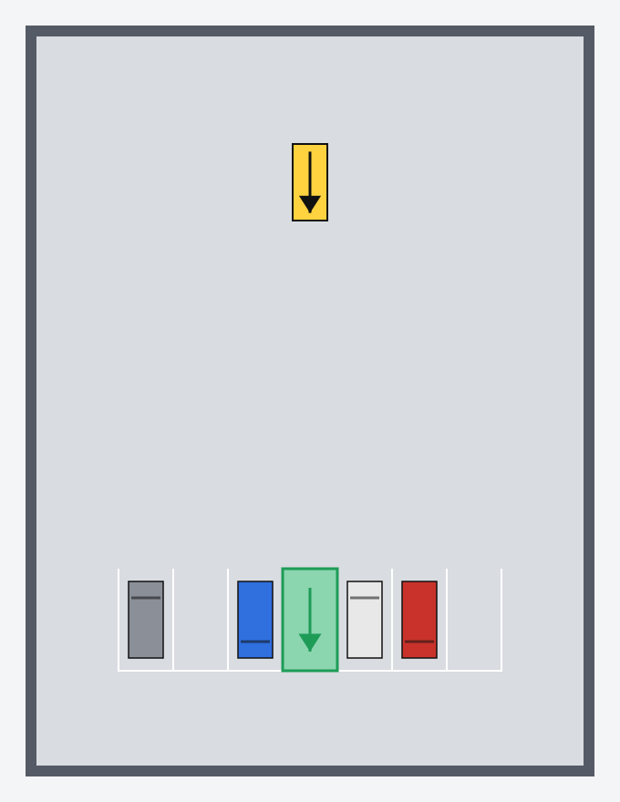

## 2. Back It In

> Reverse into the bay so the arrow and your nose point the same way.

| | |
| --- | --- |
| Id | `back-it-in` |
| Vehicle | Hatchback |
| Lot | 32 × 40 m |
| Time limit | 75 s |
| Star times | 3 stars ≤ 23 s, 2 stars ≤ 32 s, 1 star within 75 s |
| Target bay | x 4.5, z 13, 3 × 5.6 m, facing 180° (nose must point that way) |
| Start pose | x -12, z -4, heading 90° |

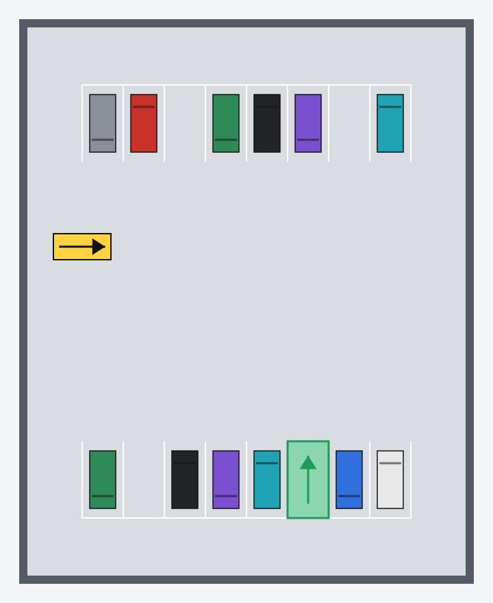

## 3. Parallel Pro

> Slip into the gap by the curb. Reverse in at an angle, then straighten up.

| | |
| --- | --- |
| Id | `parallel-pro` |
| Vehicle | Hatchback |
| Lot | 24 × 50 m |
| Time limit | 90 s |
| Star times | 3 stars ≤ 22 s, 2 stars ≤ 30 s, 1 star within 90 s |
| Target bay | x 8.1, z -0.6, 2.4 × 6.4 m, facing 0° (either direction) |
| Start pose | x 2, z -18, heading 0° |

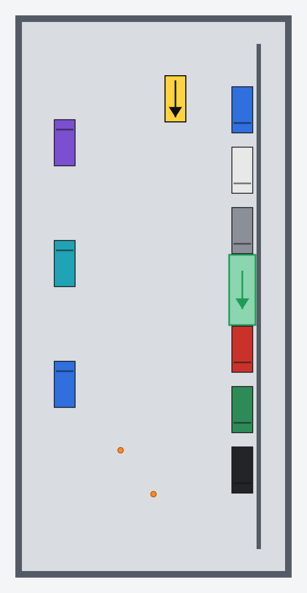

## 4. Cone Gates

> Thread through the gaps in the cones, then park at the far end.

| | |
| --- | --- |
| Id | `cone-gates` |
| Vehicle | Hatchback |
| Lot | 30 × 70 m |
| Time limit | 90 s |
| Star times | 3 stars ≤ 36 s, 2 stars ≤ 49 s, 1 star within 90 s |
| Target bay | x 3, z 28, 3 × 5.6 m, facing 0° (either direction) |
| Start pose | x 0, z -30, heading 0° |

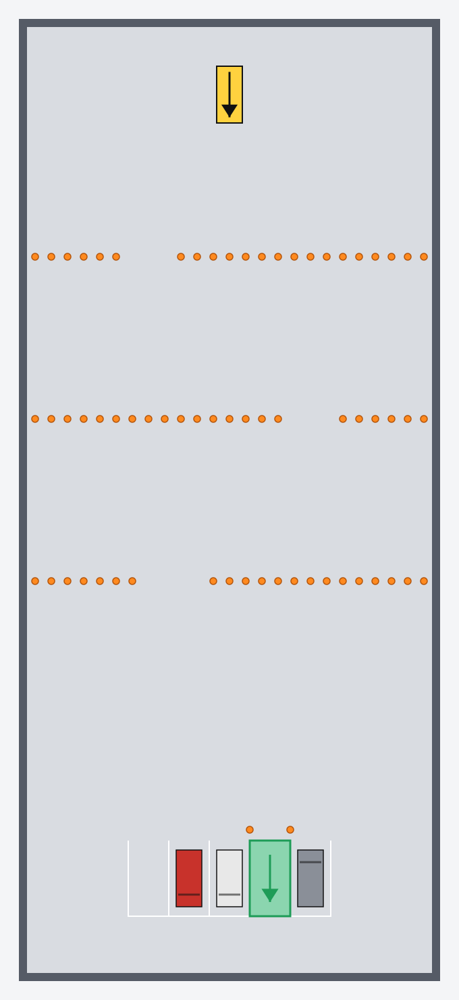

## 5. The Garage

> A tight garage with pillars in the way. Go slow.

| | |
| --- | --- |
| Id | `the-garage` |
| Vehicle | Hatchback |
| Lot | 30 × 40 m |
| Time limit | 75 s |
| Star times | 3 stars ≤ 18 s, 2 stars ≤ 25 s, 1 star within 75 s |
| Target bay | x 0, z 14.1, 2.8 × 5.4 m, facing 0° (either direction) |
| Start pose | x -10, z -14, heading 0° |

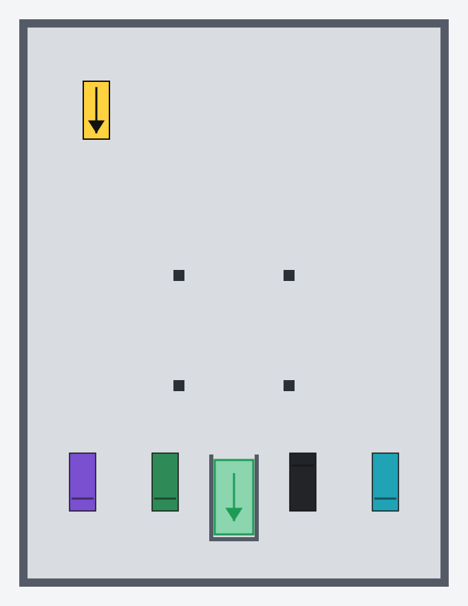

## 6. Rush Hour

> Find your way through the lot, then reverse into the last free bay.

| | |
| --- | --- |
| Id | `rush-hour` |
| Vehicle | Hatchback |
| Lot | 34 × 44 m |
| Time limit | 120 s |
| Star times | 3 stars ≤ 46 s, 2 stars ≤ 63 s, 1 star within 120 s |
| Target bay | x -3, z 18, 2.8 × 5.6 m, facing 180° (nose must point that way) |
| Start pose | x -12, z -15, heading 90° |

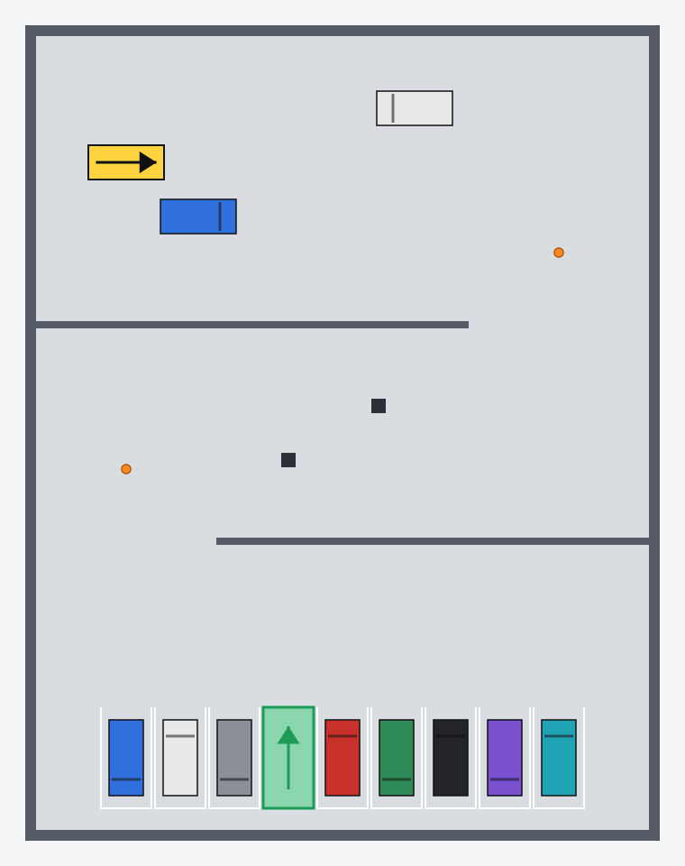

## 7. Angle of Attack

> The bays are slanted. Swing wide, then turn in and line up with the arrow.

| | |
| --- | --- |
| Id | `angle-of-attack` |
| Vehicle | Hatchback |
| Lot | 30 × 40 m |
| Time limit | 60 s |
| Star times | 3 stars ≤ 21 s, 2 stars ≤ 32 s, 1 star within 60 s |
| Target bay | x 0, z 12, 3 × 5.6 m, facing 50° (nose must point that way) |
| Start pose | x -9, z -14, heading 0° |

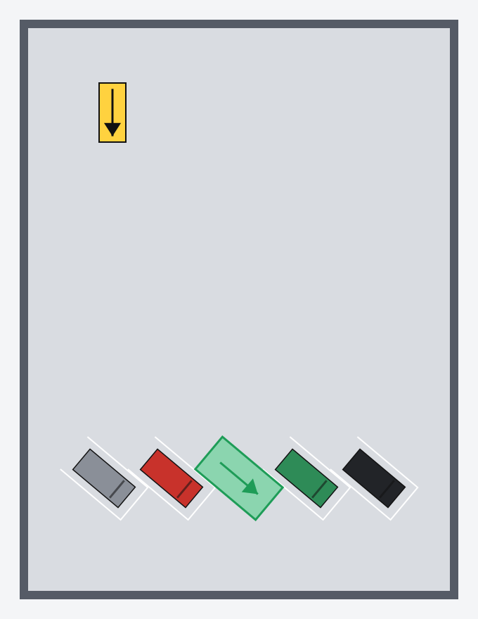

## 8. Curb Side

> A long space between two cars. Reverse in at an angle, then straighten up.

| | |
| --- | --- |
| Id | `curb-side` |
| Vehicle | Hatchback |
| Lot | 40 × 26 m |
| Time limit | 60 s |
| Star times | 3 stars ≤ 16 s, 2 stars ≤ 25 s, 1 star within 60 s |
| Target bay | x 0, z -7.2, 2.5 × 6.8 m, facing 90° (either direction) |
| Start pose | x -16, z 2, heading 90° |

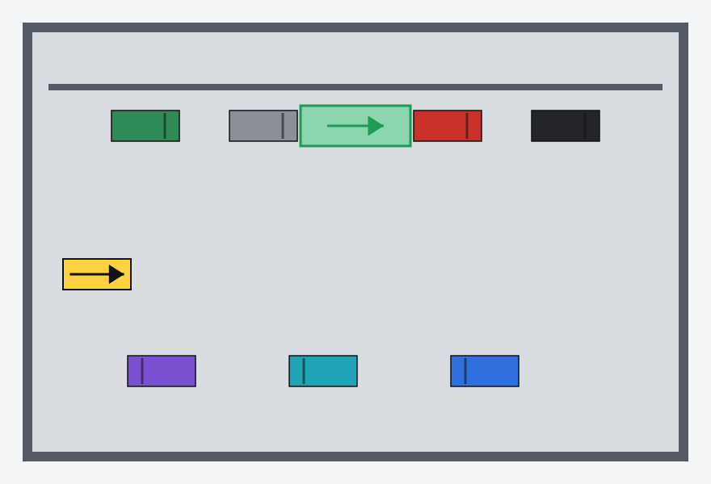

## 9. Backhand Angle

> The bays slant the other way now. Follow the arrows, swing wide and turn in.

| | |
| --- | --- |
| Id | `backhand-angle` |
| Vehicle | Hatchback |
| Lot | 30 × 40 m |
| Time limit | 60 s |
| Star times | 3 stars ≤ 21 s, 2 stars ≤ 32 s, 1 star within 60 s |
| Target bay | x 0, z 12, 3 × 5.6 m, facing 310° (nose must point that way) |
| Start pose | x 9, z -14, heading 0° |

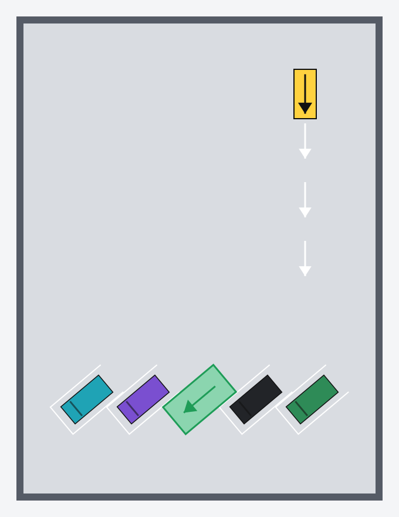

## 10. One-Way Curb

> Traffic only flows one way here. Reverse in at an angle, then straighten up.

| | |
| --- | --- |
| Id | `one-way-curb` |
| Vehicle | Hatchback |
| Lot | 40 × 26 m |
| Time limit | 60 s |
| Star times | 3 stars ≤ 16 s, 2 stars ≤ 25 s, 1 star within 60 s |
| Target bay | x 0, z -7.2, 2.5 × 6.8 m, facing 270° (either direction) |
| Start pose | x 16, z 2, heading 270° |

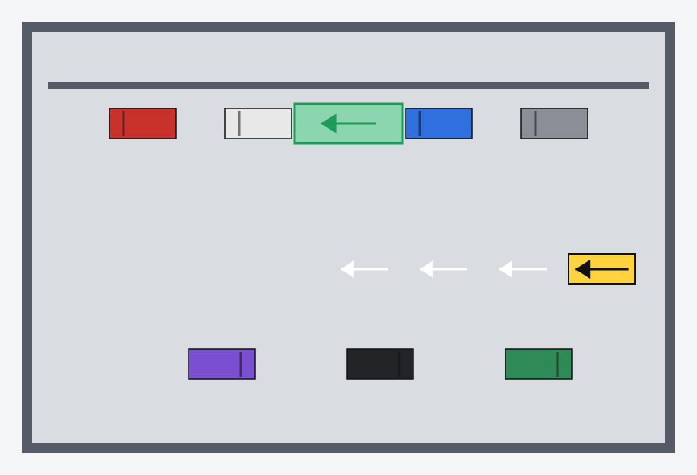

## 11. Up One Floor

> Drive up the ramp to level 1, then pull forwards into the glowing bay and stop.

| | |
| --- | --- |
| Id | `up-one-floor` |
| Vehicle | Hatchback |
| Lot | 20 × 66 m |
| Time limit | 75 s |
| Star times | 3 stars ≤ 29 s, 2 stars ≤ 40 s, 1 star within 75 s |
| Target bay | x 3, z 26, 3 × 5.6 m, facing 0°, floor `upper` (nose must point that way) |
| Start pose | x 0, z -28, heading 0° |

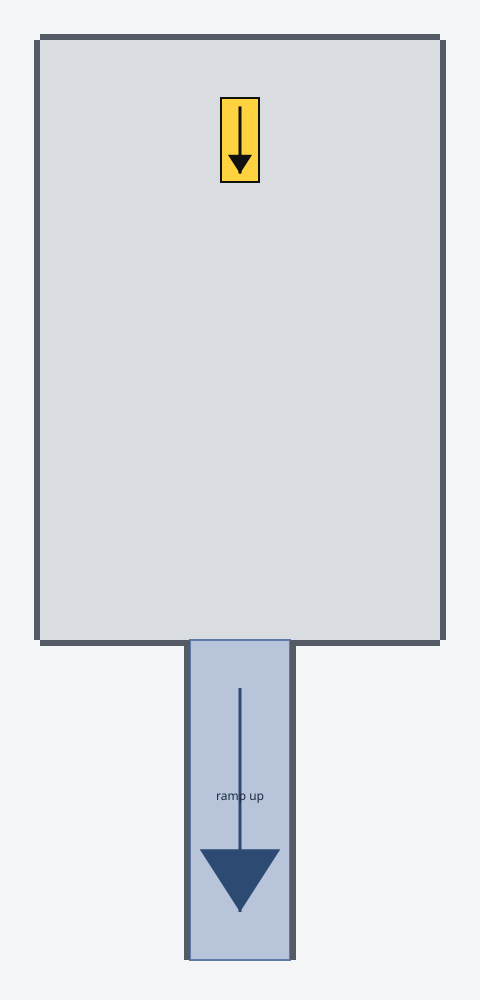

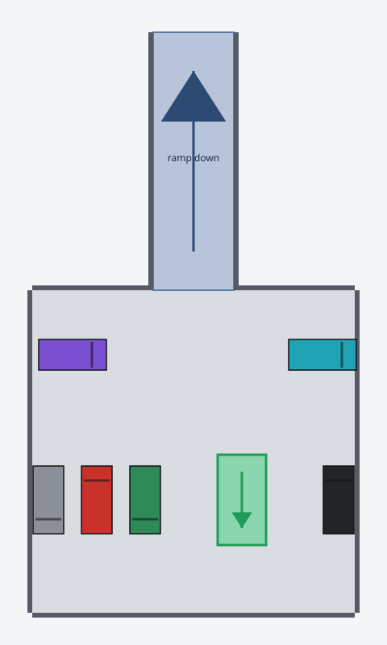

## 12. Basement

> Down the ramp into the dark. Reverse into the bay between the two cars.

| | |
| --- | --- |
| Id | `basement` |
| Vehicle | Hatchback |
| Lot | 20 × 66 m |
| Time limit | 105 s |
| Star times | 3 stars ≤ 41 s, 2 stars ≤ 57 s, 1 star within 105 s |
| Target bay | x 1, z 29, 3 × 5.6 m, facing 180°, floor `basement` (nose must point that way) |
| Start pose | x 0, z -28, heading 0° |

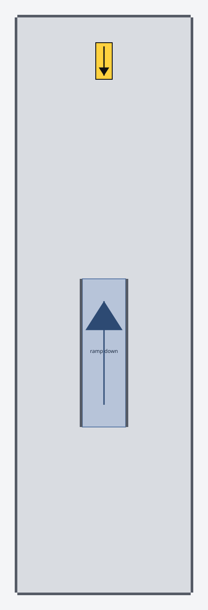

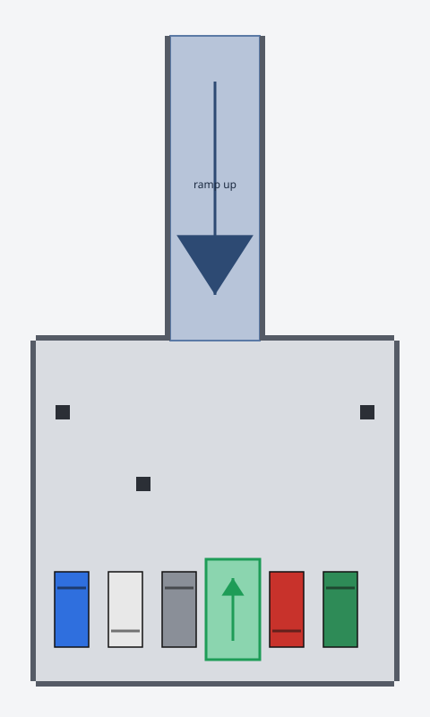

## 13. Spiral

> Keep a steady curve all the way up the spiral. The free bay is on the top deck.

| | |
| --- | --- |
| Id | `spiral` |
| Vehicle | Hatchback |
| Lot | 44 × 44 m |
| Time limit | 200 s |
| Star times | 3 stars ≤ 95 s, 2 stars ≤ 128 s, 1 star within 200 s |
| Target bay | x 13, z 12.2, 3 × 5.6 m, facing 0°, floor `top` (nose must point that way) |
| Start pose | x 15.62, z -10.58, heading 337.5° |

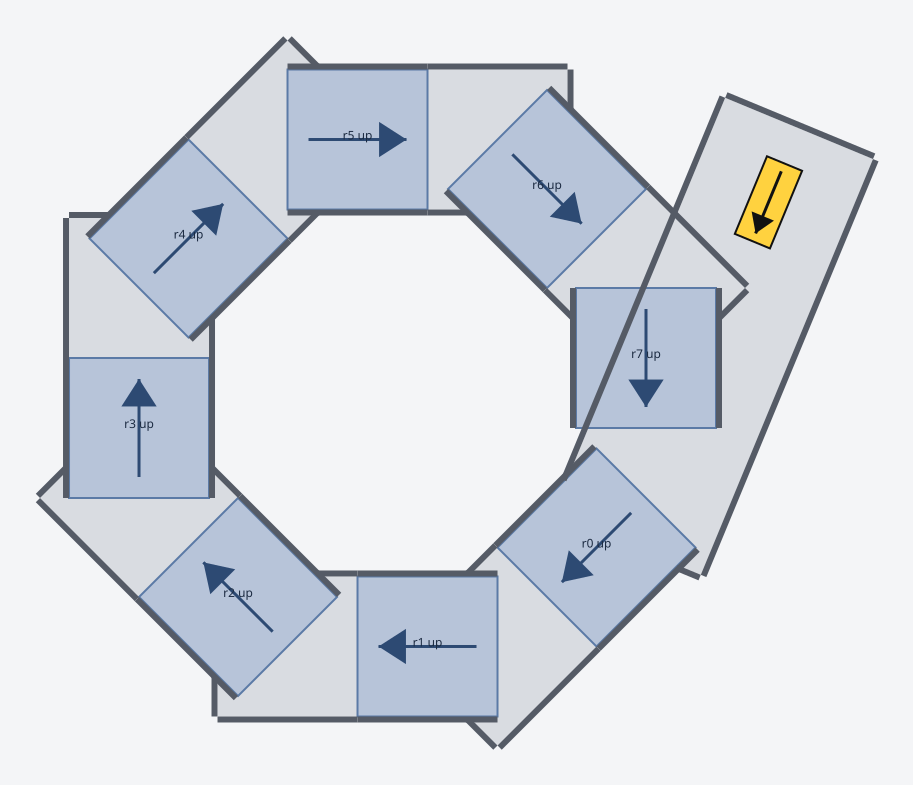

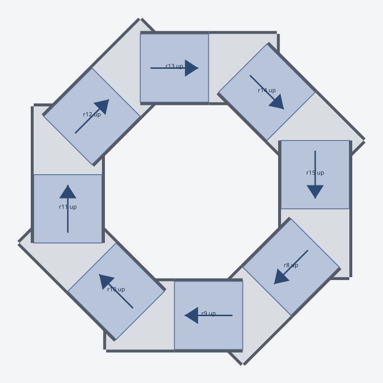

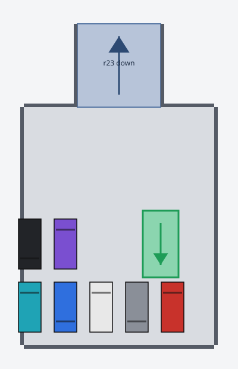

## 14. Van Garage

> A van is longer and wider than a car. Reverse into the garage bay with barely half a metre to spare each side.

| | |
| --- | --- |
| Id | `van-garage` |
| Vehicle | Van |
| Lot | 28 × 40 m |
| Time limit | 120 s |
| Star times | 3 stars ≤ 40 s, 2 stars ≤ 60 s, 1 star within 120 s |
| Target bay | x 0, z 13, 3.4 × 6.4 m, facing 180° (nose must point that way) |
| Start pose | x -9, z -12, heading 90° |

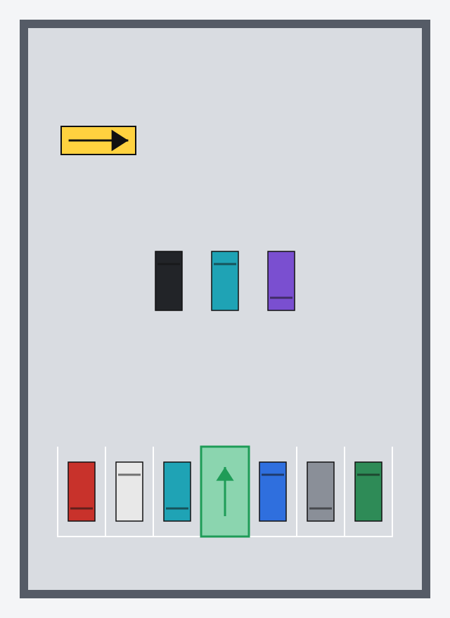

## 15. Bus Bay

> A city bus swings wide and turns slowly. Pull in alongside the platform between the two parked buses.

| | |
| --- | --- |
| Id | `bus-bay` |
| Vehicle | City Bus |
| Lot | 30 × 60 m |
| Time limit | 130 s |
| Star times | 3 stars ≤ 42 s, 2 stars ≤ 63 s, 1 star within 130 s |
| Target bay | x 8, z 0, 4.2 × 12.4 m, facing 0° (nose must point that way) |
| Start pose | x 2, z -24, heading 0° |

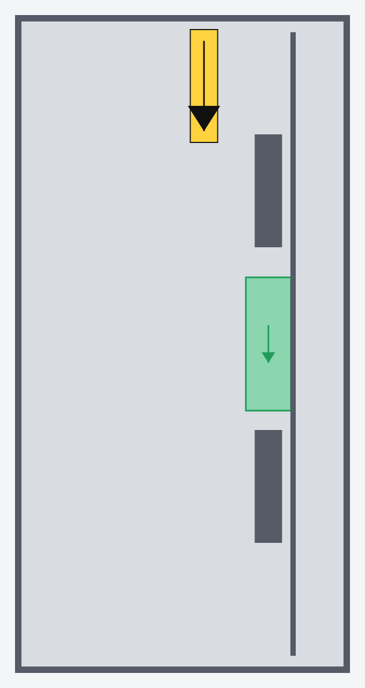

## 16. Loading Dock

> Back the box truck square into the dock. Line up early: the cargo box swings wide.

| | |
| --- | --- |
| Id | `loading-dock` |
| Vehicle | Box Truck |
| Lot | 30 × 40 m |
| Time limit | 160 s |
| Star times | 3 stars ≤ 56 s, 2 stars ≤ 84 s, 1 star within 160 s |
| Target bay | x 0, z 15.8, 3.4 × 8.4 m, facing 180° (nose must point that way) |
| Start pose | x -9, z -14, heading 90° |

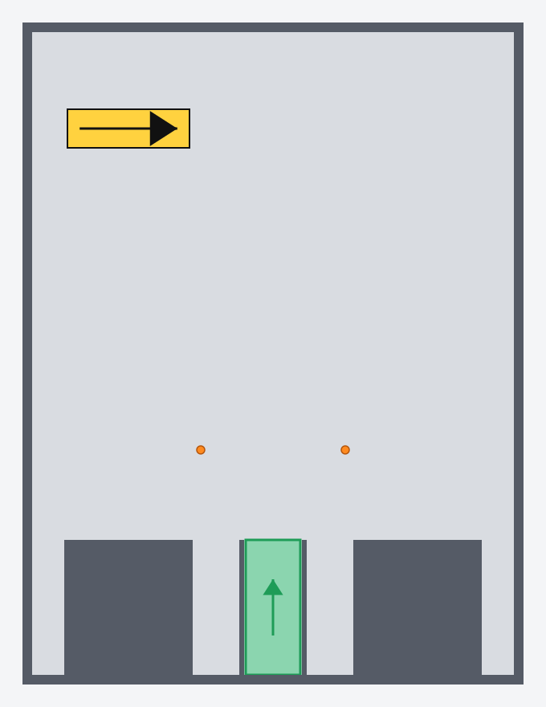

## 17. Minibus Parallel

> Parallel park the minibus at the curb. The gap is only a metre longer than the bus.

| | |
| --- | --- |
| Id | `minibus-parallel` |
| Vehicle | Minibus |
| Lot | 24 × 50 m |
| Time limit | 120 s |
| Star times | 3 stars ≤ 36 s, 2 stars ≤ 54 s, 1 star within 120 s |
| Target bay | x 8.1, z 0, 3 × 8.2 m, facing 0° (either direction) |
| Start pose | x 2, z -18, heading 0° |

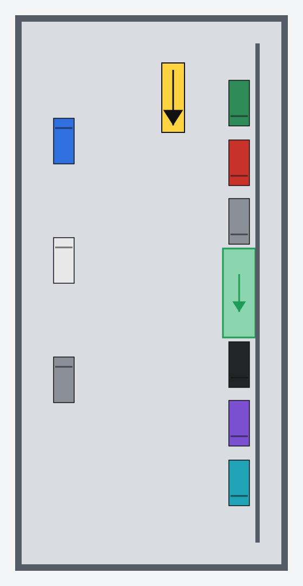

## 18. Reverse Gate

> Pass the wall, then back through the narrow gate into the bay.

| | |
| --- | --- |
| Id | `reverse-gate` |
| Vehicle | Hatchback |
| Lot | 28 × 40 m |
| Time limit | 70 s |
| Star times | 3 stars ≤ 24 s, 2 stars ≤ 36 s, 1 star within 70 s |
| Target bay | x 0, z -13, 3 × 5.6 m, facing 0° (nose must point that way) |
| Start pose | x 8, z 12, heading 180° |

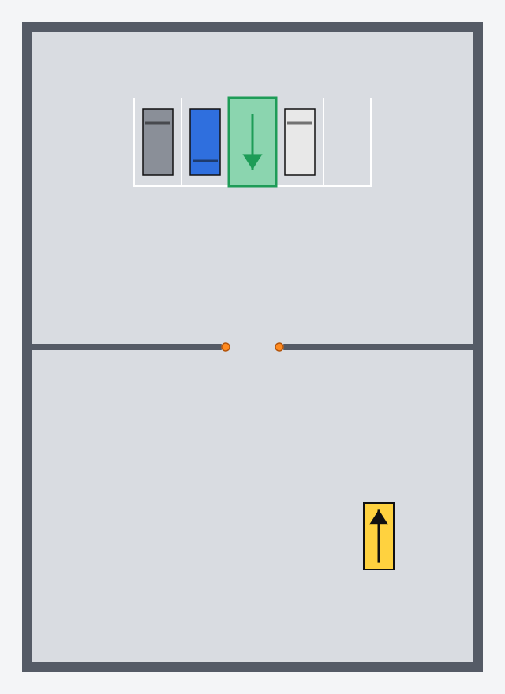

## 19. Tight Squeeze

> Only a sliver of room either side. Line up early and creep in.

| | |
| --- | --- |
| Id | `tight-squeeze` |
| Vehicle | Hatchback |
| Lot | 30 × 40 m |
| Time limit | 60 s |
| Star times | 3 stars ≤ 16 s, 2 stars ≤ 25 s, 1 star within 60 s |
| Target bay | x 0, z 12, 2.6 × 5.6 m, facing 0° (either direction) |
| Start pose | x -10, z -12, heading 90° |

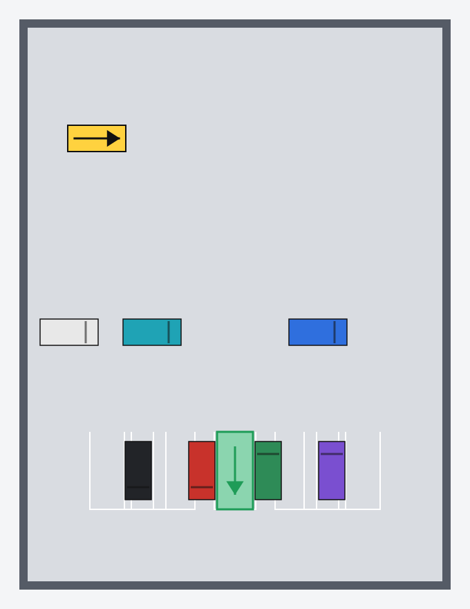

## 20. Slalom Reverse

> Weave through the cones, then reverse into the free bay on the right.

| | |
| --- | --- |
| Id | `slalom-reverse` |
| Vehicle | Hatchback |
| Lot | 30 × 60 m |
| Time limit | 90 s |
| Star times | 3 stars ≤ 40 s, 2 stars ≤ 60 s, 1 star within 90 s |
| Target bay | x 12, z 18, 2.8 × 5.6 m, facing 270° (nose must point that way) |
| Start pose | x 0, z -26, heading 0° |

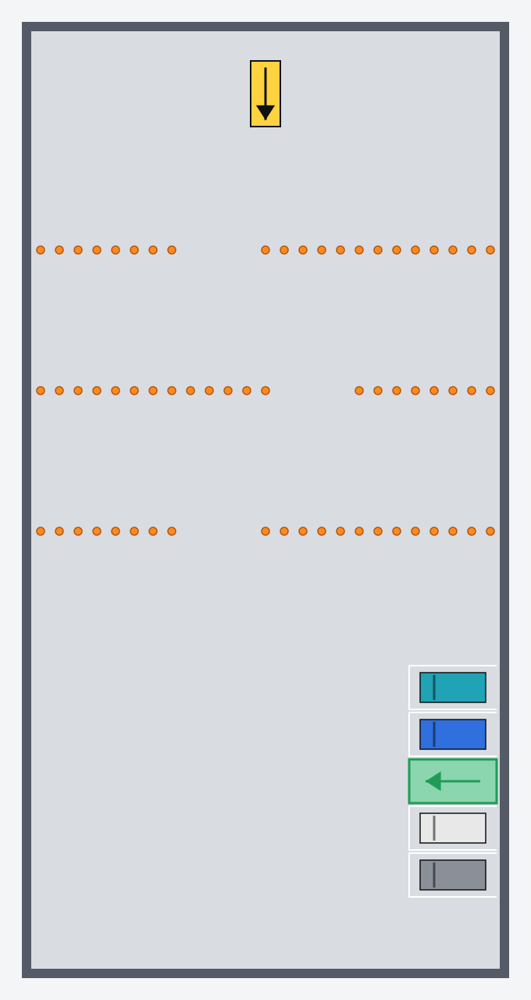

## 21. The Finale

> Pillars, a wall and a walled-in bay with almost no room. Take it slow.

| | |
| --- | --- |
| Id | `the-finale` |
| Vehicle | Hatchback |
| Lot | 30 × 40 m |
| Time limit | 100 s |
| Star times | 3 stars ≤ 39 s, 2 stars ≤ 58 s, 1 star within 100 s |
| Target bay | x 0, z 14, 2.6 × 5.8 m, facing 180° (nose must point that way) |
| Start pose | x -11, z -15, heading 90° |

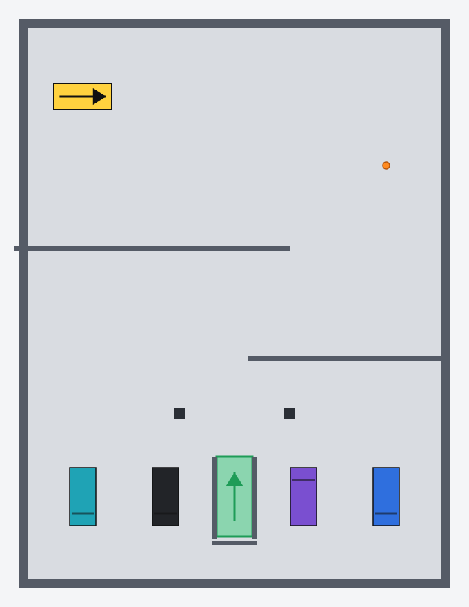

## 22. Dusk Gate

> The light is fading. Pass the wall, then back through the narrow gate into the bay.

| | |
| --- | --- |
| Id | `dusk-gate` |
| Vehicle | Hatchback |
| Lot | 28 × 40 m |
| Time limit | 70 s |
| Star times | 3 stars ≤ 24 s, 2 stars ≤ 36 s, 1 star within 70 s |
| Target bay | x 0, z -13, 3 × 5.6 m, facing 0° (nose must point that way) |
| Start pose | x -8, z 12, heading 180° |

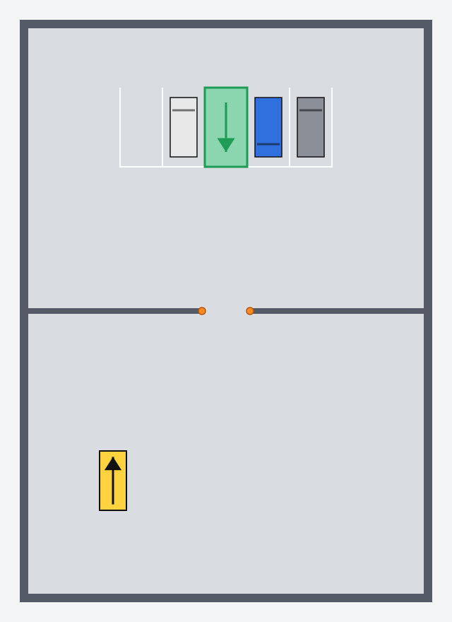

## 23. Twilight Squeeze

> Dusk and a sliver of room either side. Follow the arrows, line up early and creep in.

| | |
| --- | --- |
| Id | `twilight-squeeze` |
| Vehicle | Hatchback |
| Lot | 30 × 40 m |
| Time limit | 60 s |
| Star times | 3 stars ≤ 16 s, 2 stars ≤ 25 s, 1 star within 60 s |
| Target bay | x 0, z 12, 2.6 × 5.6 m, facing 0° (either direction) |
| Start pose | x 10, z -12, heading 270° |

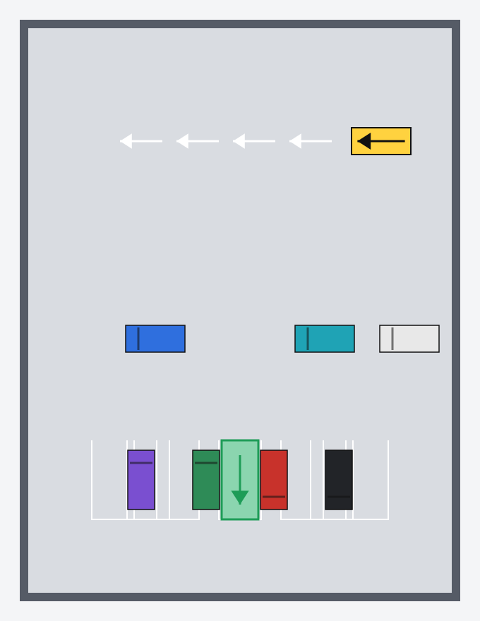

## 24. Dusk Slalom

> Weave through the cones as the sun sets, then reverse into the free bay on the left.

| | |
| --- | --- |
| Id | `dusk-slalom` |
| Vehicle | Hatchback |
| Lot | 30 × 60 m |
| Time limit | 90 s |
| Star times | 3 stars ≤ 40 s, 2 stars ≤ 60 s, 1 star within 90 s |
| Target bay | x -12, z 18, 2.8 × 5.6 m, facing 90° (nose must point that way) |
| Start pose | x 0, z -26, heading 0° |

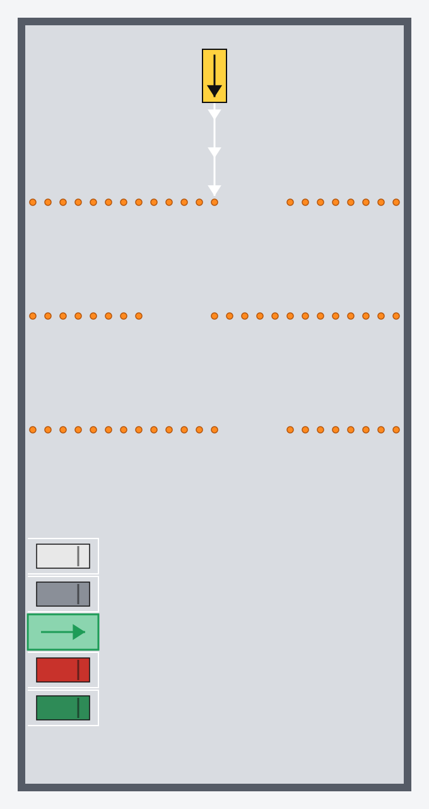

## 25. Night Finale

> Dusk, pillars, a wall and a walled-in bay with almost no room. Take it slow.

| | |
| --- | --- |
| Id | `night-finale` |
| Vehicle | Hatchback |
| Lot | 30 × 40 m |
| Time limit | 100 s |
| Star times | 3 stars ≤ 39 s, 2 stars ≤ 58 s, 1 star within 100 s |
| Target bay | x 0, z 14, 2.6 × 5.8 m, facing 180° (nose must point that way) |
| Start pose | x 11, z -15, heading 270° |

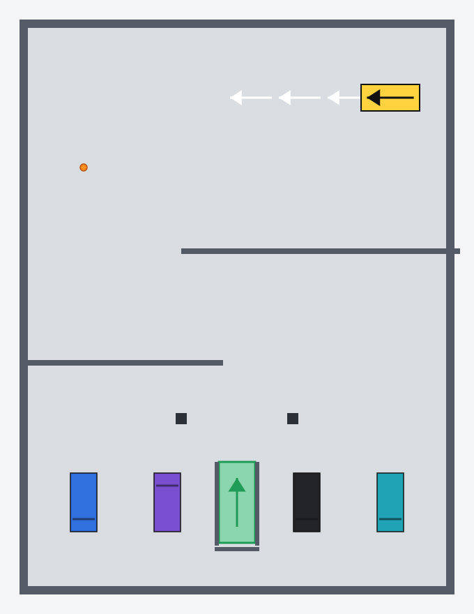

## 26. Drive-Through

> Follow the kerbed lane and stop in the bay before the barrier. Keep clear of both kerbs.

| | |
| --- | --- |
| Id | `drive-through` |
| Vehicle | Hatchback |
| Lot | 24 × 50 m |
| Time limit | 55 s |
| Star times | 3 stars ≤ 19 s, 2 stars ≤ 26 s, 1 star within 55 s |
| Target bay | x 0, z 14, 3 × 5.6 m, facing 0° (nose must point that way) |
| Start pose | x 0, z -20, heading 0° |

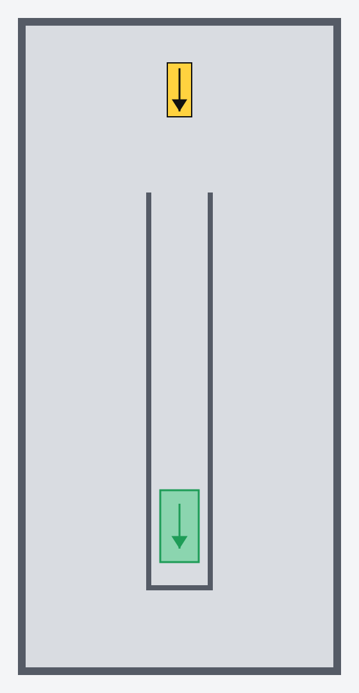

## 27. Chevron Bays

> The bays are slanted. Drive past the free one, then reverse in at the same angle.

| | |
| --- | --- |
| Id | `chevron-bays` |
| Vehicle | Hatchback |
| Lot | 38 × 30 m |
| Time limit | 70 s |
| Star times | 3 stars ≤ 25 s, 2 stars ≤ 34 s, 1 star within 70 s |
| Target bay | x 0, z 10.4, 3 × 5.6 m, facing 130° (nose must point that way) |
| Start pose | x -16, z 3, heading 90° |

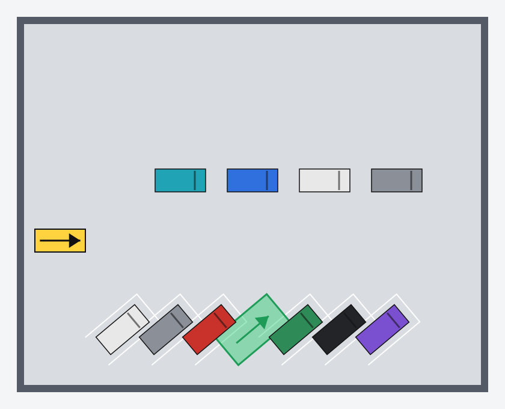

## 28. Dead-End Turn

> The alley is too narrow for a U-turn. Back out of the dead end, then swing nose-first into the side bay.

| | |
| --- | --- |
| Id | `dead-end-turn` |
| Vehicle | SUV |
| Lot | 30 × 44 m |
| Time limit | 90 s |
| Star times | 3 stars ≤ 32 s, 2 stars ≤ 44 s, 1 star within 90 s |
| Target bay | x 7.6, z -11, 3.4 × 5.6 m, facing 90° (nose must point that way) |
| Start pose | x 0, z 10, heading 0° |

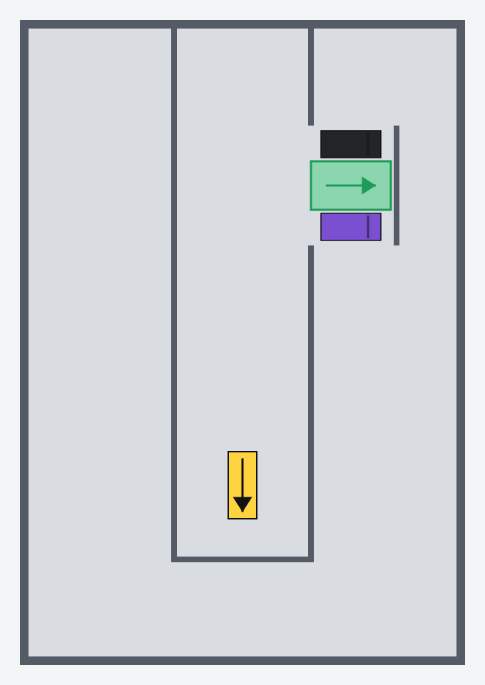

## 29. S-Bend Reverse

> Back the sedan all the way down the winding lane into the bay at the far end. Small steering, patience.

| | |
| --- | --- |
| Id | `s-bend-reverse` |
| Vehicle | Sedan |
| Lot | 30 × 46 m |
| Time limit | 100 s |
| Star times | 3 stars ≤ 35 s, 2 stars ≤ 48 s, 1 star within 100 s |
| Target bay | x -6, z -17, 3.2 × 5.6 m, facing 0° (nose must point that way) |
| Start pose | x 6, z 18, heading 0° |

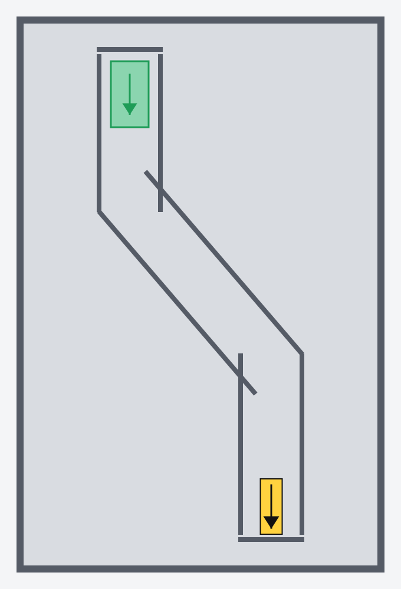

## 30. Double Parallel

> Two lorries, a kerb and a row of cars across the road. Parallel park the SUV in the gap between the lorries.

| | |
| --- | --- |
| Id | `double-parallel` |
| Vehicle | SUV |
| Lot | 24 × 50 m |
| Time limit | 80 s |
| Star times | 3 stars ≤ 27 s, 2 stars ≤ 38 s, 1 star within 80 s |
| Target bay | x 8.2, z 0, 2.6 × 6 m, facing 0° (either direction) |
| Start pose | x 3, z -20, heading 0° |

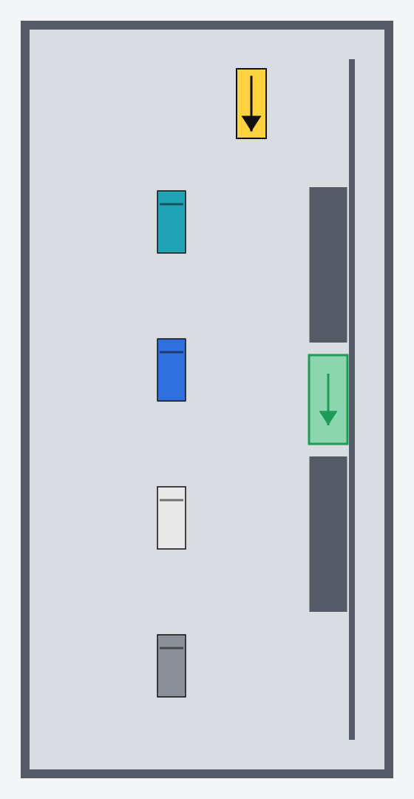

## 31. Pillar Hall

> Weave through the pillars, then reverse into the bay between a pillar and a parked car.

| | |
| --- | --- |
| Id | `pillar-hall` |
| Vehicle | Hatchback |
| Lot | 36 × 36 m |
| Time limit | 110 s |
| Star times | 3 stars ≤ 39 s, 2 stars ≤ 53 s, 1 star within 110 s |
| Target bay | x 0, z 13, 2.6 × 5.6 m, facing 180° (nose must point that way) |
| Start pose | x -14, z -14, heading 90° |

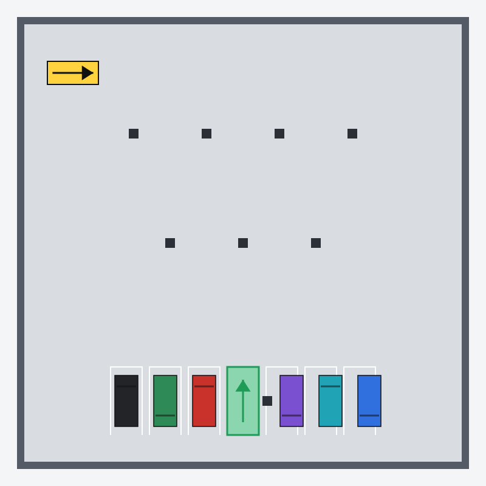

## 32. Delivery Alley

> Take the van round the tight corner, past the loading bay, then back into it.

| | |
| --- | --- |
| Id | `delivery-alley` |
| Vehicle | Van |
| Lot | 48 × 44 m |
| Time limit | 110 s |
| Star times | 3 stars ≤ 39 s, 2 stars ≤ 53 s, 1 star within 110 s |
| Target bay | x 8, z -6.2, 3.8 × 6 m, facing 0° (nose must point that way) |
| Start pose | x -14, z -18, heading 0° |

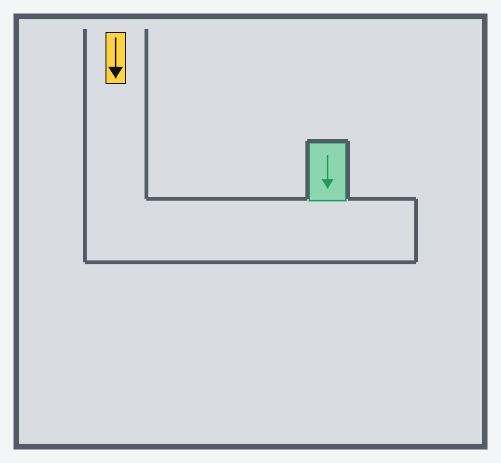

## 33. Needle Alley

> A dead end and a bay barely wider than the sedan. Back out, line up and drive nose-first into the bay on the right.

| | |
| --- | --- |
| Id | `needle-alley` |
| Vehicle | Sedan |
| Lot | 30 × 44 m |
| Time limit | 95 s |
| Star times | 3 stars ≤ 34 s, 2 stars ≤ 47 s, 1 star within 95 s |
| Target bay | x 7.3, z -11, 2.6 × 5.6 m, facing 90° (nose must point that way) |
| Start pose | x 0, z 10, heading 0° |

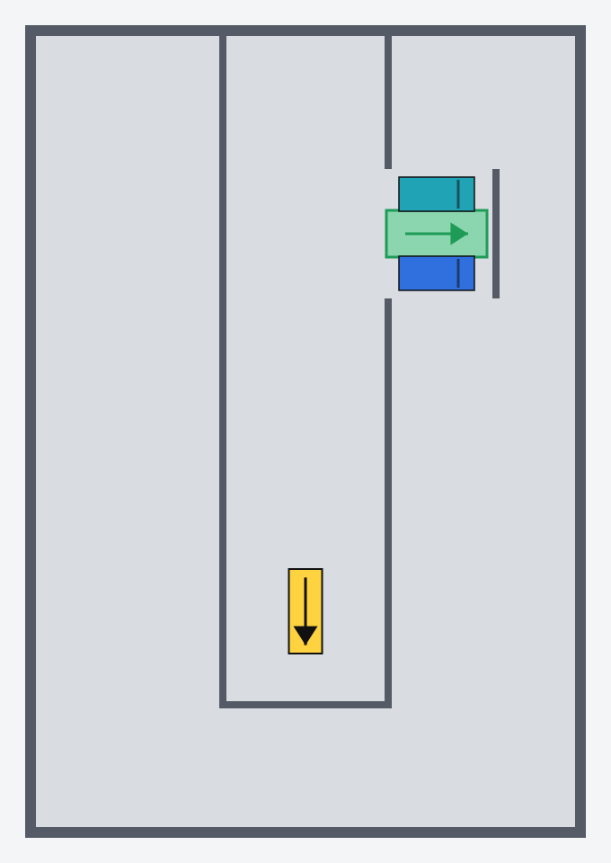
